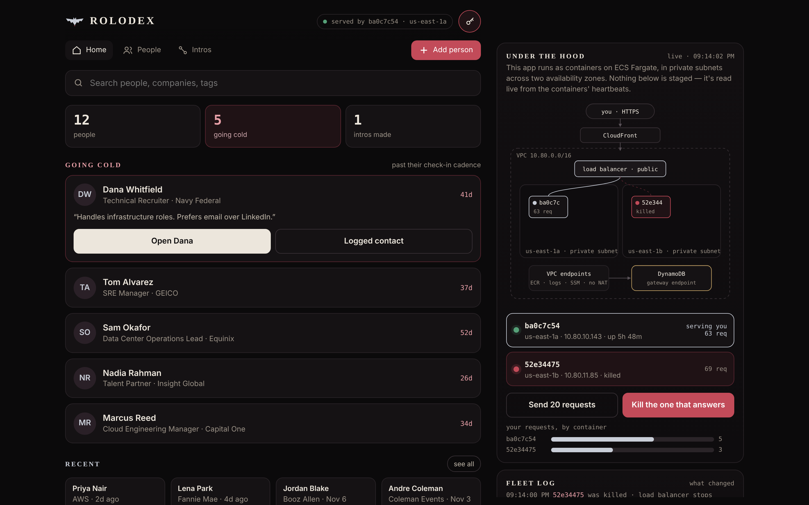

<p align="center">
  
</p>

<h1 align="center">aws-rolodex</h1>

<p align="center">
  
  
  
  
</p>

---

A contacts app for someone whose job is knowing everybody — who's going cold,
who should meet whom, what you talked about last time — running the way most
companies actually run software: **in containers, behind a load balancer, in a
private network, across two data centers.**

And it shows its own insides. A live panel draws the network, every running
container, which one answered your last request, and how the load balancer is
splitting your traffic. Hit **kill** and the container that answers dies on the
spot. Watch it go red, watch the load balancer route around it, and watch ECS
launch a replacement — while the app never goes down.



<sub>Preview build with a simulated backend. One container was just killed; the other kept serving.</sub>

<br>

## ◆ The network

```
 you ──HTTPS──► CloudFront ──HTTP + secret header──► Load balancer (public subnets, 2 AZs)
                                                         │
                         ┌───────────────────────────────┴──────────────────────────────┐
                         ▼  private subnet · us-east-1a          private subnet · us-east-1b  ▼
                    container  container                         container  container
                         │      (2 to 4, Fargate, ¼ vCPU each)           │
                         └──────────────┬──────────────────────────────────┘
                                        │  no route to the internet — none at all
                    ┌───────────────────┼─────────────────────────────┐
                    ▼                   ▼                             ▼
          interface endpoints     gateway endpoint              gateway endpoint
          ECR · logs · SSM        S3 (image layers)             DynamoDB (the data)
```

| | |
|---|---|
| **No NAT gateway** | The private subnets have no default route. Containers reach AWS only through VPC endpoints — they *can't* call the internet, even if the code tried. Cheaper than NAT, and a smaller attack surface. |
| **Each tier accepts only the tier in front of it** | The load balancer takes traffic only from CloudFront's IP ranges; containers only from the load balancer; endpoints only from containers. All security-group-to-security-group, no CIDR guesswork. |
| **CloudFront for HTTPS** | A real certificate with no domain to buy. Caching is off so every request reaches a container — the fleet panel stays honest. |
| **The load balancer refuses strangers** | CloudFront's IP ranges are shared by every AWS customer, so that alone isn't enough. CloudFront also sends a secret header; the load balancer's default answer is `403` and only requests carrying it are forwarded. Hit the ALB directly and you get turned away. |
| **Two AZs** | Containers spread across two data centers. Lose one, the other keeps serving. |

## ◆ Containers

| | |
|---|---|
| **Built in AWS** | `terraform apply` zips the app, and CodeBuild builds the image and pushes it to ECR. No Docker needed on the machine that deploys. |
| **Immutable images** | Every version gets its own tag — a hash of the code. ECR refuses to overwrite a tag, and scans each image for known vulnerabilities on push. Rolling back = pointing at an older tag. |
| **Rolling deploys** | New containers start and pass health checks before old ones stop (100% minimum healthy). A deploy never drops the site. |
| **Auto scaling on traffic** | Target tracking on requests per container: past 120/minute each, ECS adds containers (up to 4), then scales back to 2 when it's quiet. `scripts/loadtest.py` makes it happen on demand. |
| **Non-root, small** | `python:3.12-slim` from ECR Public (no Docker Hub rate limits), runs as an unprivileged user. |

## ◆ Secrets and permissions

- **The owner key** is generated by Terraform, stored encrypted in **SSM Parameter Store**, and injected by ECS when a container starts. It's not in the image, the code, or the repo. Reading is public (the contacts are fictional demo data); changing anything needs the key.
- The browser gets a **signed, HttpOnly, Secure, SameSite=Strict cookie** — not the key. Writes must be JSON, so a form on another site can't act as the owner. Five wrong guesses locks that address out for five minutes.
- **Two roles per container, on purpose.** The *execution* role is what ECS needs to start it (pull the image, write logs, read that one parameter). The *task* role is what the app can do: read and write one table. Nothing else.

## ◆ How the fleet panel works

Every container writes a heartbeat to DynamoDB every 5 seconds — its task ID,
availability zone and private IP (from the ECS task metadata endpoint), and how
many requests it has served. Heartbeats expire on their own with a DynamoDB
TTL. Every response also carries an `X-Served-By` header naming the container
that answered.

**The kill switch** marks its own heartbeat *killed*, then signals the gunicorn
master to quit. Killing only the worker process wasn't enough — gunicorn quietly
restarts a dead worker and the container never stops, so ECS never noticed.
Taking down PID 1 ends the container, and ECS launches a replacement to get back
to the desired count.

## ◆ Cost

This is the first project here that isn't free while it's running:

| | per day |
|---|---|
| Load balancer | ~$0.55 |
| 2 Fargate containers (¼ vCPU, ½ GB) | ~$0.60 |
| 4 interface endpoints (in one AZ) | ~$0.96 |
| Public IPv4 on the load balancer | ~$0.24 |
| **Total** | **~$2.35** |

So: build it, demo it, `terraform destroy`. Everything comes back with one
`terraform apply`. **A budget alarm is part of the stack** — it emails when the
month passes half of $10, or is forecast to pass $10.

## ◆ Deploy

```bash
cp terraform.tfvars.example terraform.tfvars   # put your email in it
terraform init
terraform apply                                # ~8 minutes; CloudFront is the slow part
```

Open `rolodex_url`. Get the owner key with the `owner_key_command` output. When
you're done:

```bash
terraform destroy
```

## ◆ Tests

```bash
pip install -r tests/requirements.txt
python -m pytest tests -q        # 15 passed
```

DynamoDB is mocked with moto. They cover the owner key (locked writes, forged
cookies, the lockout), input cleaning, the contact clock (a note doesn't reset
it; a text does), intros landing on both timelines, demo data seeding exactly
once across containers, and the kill switch marking itself before it exits.

---

<sub>Built by Keita · Project 08.</sub>
